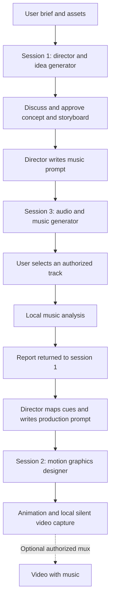

# Motion Agency

Motion Agency is a creative workflow for turning a brief into a music-synchronized, code-authored motion graphic. It uses three **separate sessions**, a local music-analysis script, and manual handoffs. The files are instructions and tools, not an automatically orchestrated application: skills and capabilities must actually be available in the chosen host.

## How it works



The order is **1 → 3 → local analysis → 1 → 2**. The user manually carries the prompts, approved storyboard, report and authorized files between sessions; no shared context or automatic skill activation is assumed.

1. **Session 1 — director and idea generator.** Use [`agents/AGENT.md`](agents/AGENT.md) with [`motion-idea-finder`](skills/motion-idea-finder/SKILL.md). Discuss the brief and collect assets in batches. Say **DONE**, or **DONE — no assets**, when finished. Review and explicitly approve the storyboard before production, unless you explicitly waive the gate. The director then supplies a self-contained prompt for music generation.
2. **Session 3 — audio and music.** Start a separate session with [`motion-audio-expert`](skills/motion-audio-expert/SKILL.md) and the director's prompt. Generate or source music using a genuinely available tool, listen to it and select an authorized track. If no generator is available, the skill can supply a prompt or other production guidance; it does not install a music model.
3. **Local analysis and return to session 1.** Run the analysis script on the selected track. Bring its text report and any listening notes back to the director. The director uses the actual report and approved storyboard to propose the visual/music cue map and a complete motion-production prompt. Resolve any duration or timing conflicts before proceeding.
4. **Session 2 — motion graphics.** Start a separate session with the production prompt, approved storyboard, report and necessary authorized assets. Use [`motion-director`](skills/motion-agency/SKILL.md), the existing skill's historical name; in this workflow it is the **motion graphics production specialist**, not the project manager. It produces browser animation code and local rendering instructions.

A silent project or bypass of the music step needs explicit user direction. An idea choice, DONE or a music selection is not storyboard approval. Do not silently change approved visuals, exact copy, duration or audio. A new session cannot be assumed to have earlier approvals or assets.

## Local music analysis

[`scripts/analyze_music.py`](scripts/analyze_music.py) processes the track locally and writes:

- A readable `*.analysis.txt` report for the director.
- A `*.analysis.json` report with the same structured timing information.

The reports include a source SHA-256, duration, estimated BPM, estimated beat timestamps, detected onsets and fixed-window RMS energy. Beat/onset timing and BPM are **estimates** and can be wrong, including half/double-tempo estimates. Onsets are not guaranteed musical beats or scene cuts. Energy is RMS dBFS, not LUFS or identified musical sections. The script does not identify instruments, vocals, lyrics, mood, downbeats or rights. Listen to the track and verify chosen cues; do not claim Gemini heard the music merely because it read the report.

### Setup

Requires Python 3.10+ and the pinned packages in [`requirements-music.txt`](requirements-music.txt); tested together with Python 3.13. Installation can require network access and local approval. Processing itself is local and does not upload the track. Use only audio you have permission to process and share.

From the repository root on macOS/Linux:

```bash
python3 -m venv .venv
.venv/bin/python -m pip install -r requirements-music.txt
.venv/bin/python scripts/analyze_music.py /path/to/selected-track.wav --output-dir analysis
```

On Windows PowerShell:

```powershell
python -m venv .venv
.\.venv\Scripts\python.exe -m pip install -r requirements-music.txt
.\.venv\Scripts\python.exe scripts\analyze_music.py C:\path\to\selected-track.wav --output-dir analysis
```

Replace the example path with the actual audio file. WAV and FLAC are recommended; MP3 and other formats depend on your local libsndfile support. For an unsupported format, an approved local FFmpeg installation can create a WAV copy:

```bash
ffmpeg -i selected-track.mp3 -c:a pcm_s16le selected-track.wav
```

Analyze and identify the WAV copy, and use that same version for synchronization where practical. The hash identifies the analyzed file, so a converted copy has a different hash from its source; check any offset or duration change before using it. Keep the original unchanged.

The default input limit is 600 seconds. Use `--max-seconds 900` only when intentionally analyzing a longer file; longer files require more memory and time. Use `--window 1` to choose a one-second energy window. The script refuses to replace either existing report unless `--overwrite` is explicitly supplied. See all options with:

```bash
python scripts/analyze_music.py --help
```

The reports can reveal a file name, hash and timing. Share them only with authorized people. Do not commit project audio or reports to the repository. The script cannot itself prove the user has permission to use a track.

## Repository structure

| Path | Purpose |
| --- | --- |
| [`agents/AGENT.md`](agents/AGENT.md) | Session 1 launcher and project-management workflow. |
| [`skills/motion-idea-finder/SKILL.md`](skills/motion-idea-finder/SKILL.md) | Creative director: discovery, storyboard, music prompt and production handoff. |
| [`skills/motion-audio-expert/SKILL.md`](skills/motion-audio-expert/SKILL.md) | Session 3 music direction and generation handoff. |
| [`skills/motion-agency/SKILL.md`](skills/motion-agency/SKILL.md) | Session 2 motion graphics production and capture guidance; metadata name `motion-director`. |
| [`skills/motion-agency/references/`](skills/motion-agency/references/) | Visual styles, storyboarding, techniques, Gemini, creative recipes, Three.js, GSAP and Anime.js guides. |
| [`scripts/analyze_music.py`](scripts/analyze_music.py) | Local timing and energy analysis; no audio upload. |
| [`requirements-music.txt`](requirements-music.txt) | Dependencies for the local analysis script. |

## Installing and using the skills

If your host supports skill uploads, install or select the skills in the sessions where they are needed. Confirm that the metadata name displayed in the host is correct and that included references are accessible. The motion production directory is named `motion-agency` but its skill metadata is `motion-director`; if your host requires matching names, use a copy of the folder named `motion-director`. Uploading a single `SKILL.md` does not install sibling references. These reference paths may not be accessible from the separately installed idea or audio skill.

To package the production skill with its references, run from the repository root:

```bash
cd skills/motion-agency
python3 -m zipfile -c ../../motion-agency-skill.zip SKILL.md references
```

The idea and audio skills each have their own `SKILL.md` and are installed or attached separately. If skills cannot be installed, attach the relevant instructions as context in each session. Attach `agents/AGENT.md` to the director's opening message. An attachment does not itself activate a skill. Availability, selectors, attachment limits, image generation and Canvas compatibility vary by host, account and configuration; check current documentation and the interface.

## Animation and video

The production session creates a browser animation with explicitly declared, version-pinned dependencies. Three.js can provide real 3D; GSAP or Anime.js can provide coordinated timelines. A generated project should expose `window.__motion = { duration, fps, width, height, seek, pause, ready }` and a `#motion-stage` so an external capture process can seek to exact times. Dependencies are not bundled by this repository. A CDN-backed page requires permitted network access; a local bundle has its own licensing and setup requirements.

The production skill includes a Python/Playwright/Chromium and FFmpeg capture tutorial. Its frame sequence produces a **silent MP4**. Adding the selected authorized audio is a separate playback or muxing step; verify sync and rights. A browser animation, a soundtrack, a preview and a rendered video are distinct deliverables. Review the generated code and test in the intended environment.

## Troubleshooting

| Problem | Suggested action |
| --- | --- |
| A session cannot see an earlier prompt, approval or file | Manually transfer the approved board, handoff, report and authorized assets; ask for missing details. |
| A skill is unavailable | Select it explicitly where possible, or attach its instructions and relevant references. An attachment does not install it. |
| Music cannot be generated or heard in the session | Use an available authorized music tool or composer; return the selected track and local report to the director. |
| Audio cannot be decoded | Use a WAV or FLAC file or convert a copy locally; analyze the same version intended for synchronization. |
| Analysis finds no beats | Check for silence, a very short track or weak rhythmic cues; listen and provide verified timestamps. |
| Reports already exist | Use a new output directory or explicitly pass `--overwrite`. |
| Music and approved storyboard have different durations | Ask the director/user to choose an edit or approve a storyboard revision; do not silently alter either. |
| Animation preview or export differs | Check library imports, WebGL, CSP, fonts, assets, dimensions, pause, deterministic seeking and fps. |

## Contributing and license

When changing the workflow, keep the launcher, all three skills, references and this README consistent; test the DONE and storyboard gates, handoffs, source identity and timing behavior. Never commit private assets, credentials or unauthorized materials. There is no license file in this repository; review permissions before reuse or redistribution. Third-party animation libraries and dependencies have their own licenses.

External reference guides: [Three.js](https://threejs.org/docs/), [GSAP](https://gsap.com/docs/), [Anime.js](https://animejs.com/documentation/), and [Gemini skill guidance](https://support.google.com/gemini/answer/17094296?hl=en&co=GENIE.Platform%3DDesktop). Links do not install or activate these tools.
